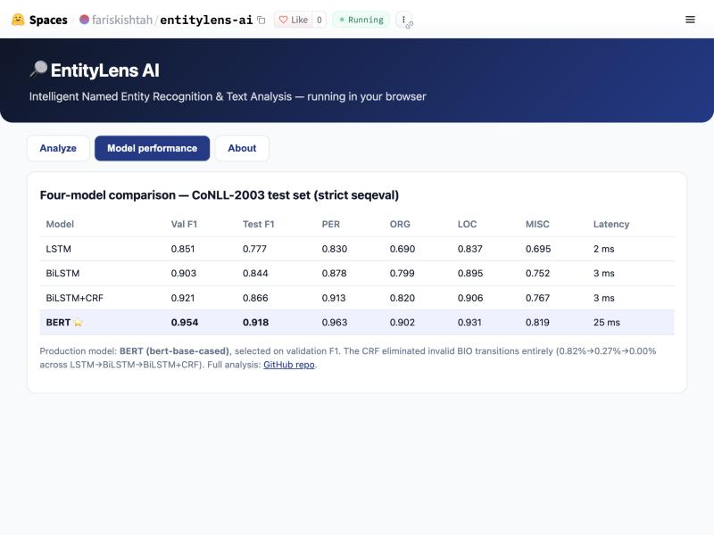

<div align="center">

# 🔎 EntityLens AI

### Intelligent Named Entity Recognition & Text Analysis Platform

[](https://www.python.org/)
[](https://pytorch.org/)
[](https://gradio.app/)
[](tests/)
[](LICENSE)

Four NER architectures trained on CoNLL-2003, compared under a strict
entity-level protocol, served through a polished entity-highlighting app.

**🚀 Live demo:** [huggingface.co/spaces/fariskishtah/entitylens-ai](https://huggingface.co/spaces/fariskishtah/entitylens-ai) ·
**🤗 Model:** [fariskishtah/entitylens-ai](https://huggingface.co/fariskishtah/entitylens-ai) ·
**Dataset:** CoNLL-2003

</div>

---

## Overview

EntityLens AI is an end-to-end Named Entity Recognition system. It identifies
**people, organizations, locations and miscellaneous** entities in English text,
highlights them with exact character offsets, and exposes extraction, statistics,
an entity inspector and batch processing through a professional Gradio interface.

The project trains and compares **four architectures** — a word-level LSTM, a
BiLSTM, a BiLSTM+CRF, and a fine-tuned BERT — under one strict, reproducible
evaluation protocol, then deploys the model selected on validation performance.

### Problem statement

NER is **token-level sequence labeling**, not text classification: every token
receives a BIO tag and entities are scored as whole spans. A prediction is
correct only when the *entire* span and its type match the gold annotation, which
makes boundary decisions and tag consistency decisive. EntityLens treats the task
accordingly — entity-level `seqeval` metrics throughout, never token accuracy as
the headline number.

## Dataset

- **Source:** CoNLL-2003 English NER, loaded from the `tomaarsen/conll2003`
  parquet distribution on the Hugging Face Hub (no remote-code execution).
- **Official splits (frozen, unchanged):** train **14,041** / validation **3,250**
  / test **3,453** sentences (203,621 / 51,362 / 46,435 tokens).
- **Entities:** 23,499 / 5,942 / 5,648 across train/val/test.
- **Tagging scheme:** IOB2 / BIO2 — verified programmatically (0 invalid
  transitions in any split; no sentence starts with an `I-` tag).
- **Licensing / attribution:** CoNLL-2003 annotations derive from the Reuters
  RCV1 corpus and are a standard NER research benchmark (Tjong Kim Sang & De
  Meulder, 2003). The **corpus tokens/sentences are NOT redistributed** in this
  repository — no Parquet, CSV or raw text is committed, and the full git
  history is free of Reuters-derived tokens. Only **derived statistics**
  (`data_audit.json`) and **provenance with SHA-256 checksums**
  (`dataset_provenance.json`) are committed. Reproducibility is preserved by
  regenerating the frozen splits locally from the Hugging Face source:
  `python scripts/prepare_data.py` (the checksums let you verify you obtained the
  identical splits). Please consult the original dataset terms before
  redistributing the underlying text.

### Data audit (reproducible — `data/processed/data_audit.json`)

| Metric | Train | Val | Test |
|---|---|---|---|
| Sentences | 14,041 | 3,250 | 3,453 |
| Tokens | 203,621 | 51,362 | 46,435 |
| Entities (PER/ORG/LOC/MISC) | 6,600 / 6,321 / 7,140 / 3,438 | 1,842 / 1,341 / 1,837 / 922 | 1,617 / 1,661 / 1,668 / 702 |
| Invalid BIO transitions | 0 | 0 | 0 |
| Cross-split OOV (token) | — | 7.54 % | 10.87 % |

**Honest benchmark note:** CoNLL-2003 contains a small number of sentences that
recur across splits (train↔val 129, train↔test 78, val↔test 25) — mostly short,
repeated sport-score lines. This is a documented property of the benchmark. We
**preserve the official splits** rather than silently reshuffle, so our numbers
remain comparable to the literature; the overlap is reported here for
transparency.

## Preprocessing

- **BIO encoding/decoding** with a single canonical `label2id`/`id2label` shared
  by every model and the app.
- **Vocabulary built from the training split only** (no leakage); unknown words
  map to `<unk>`.
- **Out-of-vocabulary handling** via a **character-level CNN**, so even words
  absent from GloVe receive a morphology-aware representation (motivated by the
  ~8–11 % OOV rate above).
- **Pretrained embeddings:** real **GloVe 6B (100-d)** vectors, **87.6 % vocab
  coverage** (18,416 / 21,011 words); unmatched words get small random vectors.
- **Transformer alignment:** the fast tokenizer's `word_ids()` map word labels to
  sub-words; only the **first sub-word** of each word is scored, special tokens
  and padding are ignored (`-100`), and predictions are realigned to word level
  before metrics — so sub-words never inflate the score.

## Model architectures

| # | Model | Encoder | Decoder | Params |
|---|---|---|---|---|
| 1 | **LSTM** | GloVe + char-CNN → unidirectional LSTM | softmax per token | 2.37 M |
| 2 | **BiLSTM** | GloVe + char-CNN → bidirectional LSTM | softmax per token | 2.64 M |
| 3 | **BiLSTM+CRF** | GloVe + char-CNN → BiLSTM → linear emissions | **linear-chain CRF** (Viterbi) | 2.64 M |
| 4 | **BERT** | `bert-base-cased` (fine-tuned) | token-classification head | 108 M |

- The **CRF** is a real `pytorch-crf` layer: sequence-level negative
  log-likelihood loss and Viterbi decoding, with **hard IOB2 transition
  constraints** (illegal moves such as `O → I-PER` forced to −10⁴ and re-applied
  after every optimizer step).
- Padded positions never contribute to the loss (CrossEntropy `ignore_index` /
  CRF mask), and variable-length sequences are packed.

### Training methodology

- Fixed seed (42), Adam, gradient clipping (5.0), dropout (0.5), ReduceLROnPlateau
  on validation F1, **early stopping** on entity-level validation F1, full history
  + resumable checkpoints.
- **Recurrent models** trained locally on Apple-Silicon **MPS**; **BERT**
  fine-tuned on **Kaggle T4 GPU** (`notebooks/kaggle_train_transformer.ipynb`,
  launched headlessly via `scripts/kaggle_launch.py`).
- **Model selection uses validation F1 only**; the test split is evaluated once,
  at the end.

## Results

All models evaluated on the **held-out test split** with identical strict
`seqeval` (IOB2) scoring; latency measured on CPU (mean ms/sentence).

| Model | Val F1 | Precision | Recall | **Entity F1** | Train time (s) | Latency (ms) | Params | Size (MB) |
|---|---|---|---|---|---|---|---|---|
| LSTM | 0.8513 | 0.786 | 0.769 | 0.777 | 1,466 (MPS) | 1.8 | 2.37 M | 9.5 |
| BiLSTM | 0.9030 | 0.846 | 0.842 | 0.844 | 2,373 (MPS) | 2.5 | 2.64 M | 10.6 |
| BiLSTM+CRF | 0.9206 | 0.874 | 0.857 | 0.866 | 6,340 (MPS) | 2.6 | 2.64 M | 10.6 |
| **BERT** (bert-base-cased) ⭐ | **0.9537** | 0.914 | 0.922 | **0.918** | 508 (T4 GPU) | 25.0 | 107.7 M | 432 |

⭐ = selected production model (highest **validation** F1). Entity F1 is strict
entity-level `seqeval` on the **held-out test split**. **Training times are not
directly comparable**: the recurrent models trained on Apple-Silicon **MPS**, BERT
on a **Kaggle T4 GPU** — the GPU's shorter wall-clock reflects hardware, not a
lighter model. CPU inference latency is measured identically for all four.

### Per-class F1 (test)

| Model | PER | ORG | LOC | MISC |
|---|---|---|---|---|
| LSTM | 0.830 | 0.690 | 0.837 | 0.695 |
| BiLSTM | 0.878 | 0.799 | 0.895 | 0.752 |
| BiLSTM+CRF | 0.913 | 0.820 | 0.906 | 0.767 |
| **BERT** | **0.963** | **0.902** | **0.931** | **0.819** |

Every model finds **LOC** and **PER** easiest and **MISC** hardest (MISC is an
open, heterogeneous class). BERT's contextual sub-word representations give the
largest gains on **ORG** and **MISC**, the two types most dependent on context.

### CRF impact analysis (BiLSTM vs BiLSTM+CRF)

Adding the CRF to the BiLSTM produced a **measured, consistent improvement**:

| | BiLSTM | BiLSTM+CRF | Δ |
|---|---|---|---|
| Entity F1 (test) | 0.8439 | **0.8656** | **+0.0217** |
| Validation F1 | 0.9030 | **0.9206** | +0.0176 |
| PER F1 | 0.878 | **0.9125** | +0.034 |
| Invalid BIO transition rate | 0.27 % | **0.00 %** | eliminated |

- **Entity-boundary & consistency:** the CRF models tag-to-tag transitions, so it
  learns that `I-X` can only follow `B-X`/`I-X`. With the hard IOB2 constraints it
  produces **zero invalid transitions** on the test set (vs 0.27 % for the plain
  BiLSTM and 0.82 % for the LSTM). Illegal, un-decodable spans simply cannot occur.
- **Where CRF helps most:** multi-token entities and types where boundaries are
  ambiguous — the largest gain is on **PER** (+3.4 F1), which is dominated by
  multi-token person names. Overall recall and precision both rise.
- **Where it helps least:** single-token entities already tagged consistently by
  the BiLSTM gain little; the CRF's benefit is concentrated on span structure, not
  on individual-token disambiguation.

This matches NER theory: a CRF adds value precisely when valid **sequence
structure** matters, which is why it is the strongest recurrent model here.

## Application features

- **Entity highlighting** with a distinct, accessible color per type and a legend;
  rendered on the *original* text via exact character offsets (punctuation,
  spacing and repeated mentions preserved; all text HTML-escaped).
- **Extracted-entities table** — text, type, char start/end, confidence.
- **Statistics** — totals, per-category counts, unique entities.
- **Entity inspector** — span, offsets, label meaning, confidence (reported
  honestly as a raw model score, *not* a calibrated probability).
- **Batch CSV processing** with downloadable JSON (in-memory, nothing persisted).
- **Model-performance dashboard** with the genuine four-model comparison.
- Empty-state handling, input-length limits, Unicode safety, responsive layout.

## Deployment

The production BERT model is published to the Hugging Face Hub and served two ways:

- **🤗 Model repo** — [`fariskishtah/entitylens-ai`](https://huggingface.co/fariskishtah/entitylens-ai):
  the fine-tuned `bert-base-cased` weights, usable directly with
  `transformers.pipeline("token-classification", "fariskishtah/entitylens-ai")`,
  plus a quantized ONNX build for the browser.
- **🚀 Live demo (static Space)** —
  [`spaces/fariskishtah/entitylens-ai`](https://huggingface.co/spaces/fariskishtah/entitylens-ai):
  runs the quantized model **entirely in the browser** via
  [transformers.js](https://github.com/xenova/transformers.js) — no backend, no data leaves the device.

> **Why a static Space?** Hugging Face now requires a paid **PRO** subscription to
> host Gradio/Docker Spaces on free CPU. Rather than pay, EntityLens ships the same
> model as a **free** static Space that runs client-side via transformers.js.

### Two ways to run the app (explicit)

| | **Static Space** (deployed, public) | **Gradio app** (`app.py`, local) |
|---|---|---|
| Runtime | In the browser (transformers.js + WASM) | Python server on your machine |
| Model | Int8-**quantized ONNX** (~104 MB, downloaded once to the browser) | Full-precision **PyTorch** `bert-base-cased` |
| Features | Highlighting, table, stats, performance tab | All of those + entity inspector, batch CSV, export |
| Hosting | Free HF static Space | `python app.py` (localhost) |

### Quantized-ONNX vs PyTorch consistency (measured, not assumed)

The browser model is a dynamically int8-quantized ONNX export. It was evaluated on
the **same frozen CoNLL-2003 test split with the identical strict seqeval protocol**:

| | Test F1 | Precision | Recall | PER | ORG | LOC | MISC |
|---|---|---|---|---|---|---|---|
| PyTorch `bert-base-cased` | 0.9178 | 0.914 | 0.922 | 0.963 | 0.902 | 0.931 | 0.819 |
| **Quantized ONNX (browser)** | **0.9174** | 0.914 | 0.921 | 0.965 | 0.903 | 0.933 | 0.808 |
| Δ (quantization) | **−0.0004** | ≈0 | −0.001 | +0.002 | +0.001 | +0.002 | −0.011 |

Quantization costs **0.04 F1 points** overall; the only notable per-type change is
**MISC** (−1.1 F1). The browser demo therefore reproduces the production model's
accuracy almost exactly — the ~0.918 test F1 quoted above is the PyTorch model's;
the browser model's independently measured value is **0.9174**.

## Screenshots

Live four-model performance dashboard on the deployed Space:



The **Analyze** tab highlights detected entities inline (colour-coded by type,
with an extracted-entities table and live statistics); try it on the
[live demo](https://huggingface.co/spaces/fariskishtah/entitylens-ai).

## Installation & reproduction

```bash
git clone https://github.com/fariskishtah/entitylens-ai
cd entitylens-ai
python3.12 -m venv .venv && source .venv/bin/activate
pip install -r requirements-dev.txt

# 1) download CoNLL-2003 from the HF source + freeze splits locally + audit
#    (corpus Parquet is NOT committed; this regenerates it under data/processed)
python scripts/prepare_data.py

# 2) train the recurrent models (local)
python scripts/train_all_rnn.py

# 3) fine-tune BERT on Kaggle GPU (needs ~/.kaggle/kaggle.json)
python scripts/kaggle_launch.py --push      # run, then --status / --pull

# 4) evaluate all four + build the comparison and figures
python scripts/evaluate_all.py
python scripts/make_figures.py

# 5) run the app
python app.py
```

Run the tests:

```bash
python -m pytest tests/ -q
```

## Project structure

```
entitylens-ai/
├── app.py                      # Gradio application
├── src/entitylens/
│   ├── labels.py               # canonical BIO label scheme
│   ├── data/                   # dataset, audit, vocab, GloVe, alignment, collate
│   ├── models/                 # LSTM, BiLSTM, BiLSTM+CRF, char-CNN, factory
│   ├── training/               # RNN trainer, transformer trainer, utils
│   ├── evaluation/             # seqeval entity-level metrics
│   ├── inference/              # offset tokenizer, span decoding, Predictor
│   └── app_utils.py            # highlighting / stats / CSV (unit-tested)
├── scripts/                    # prepare_data, train_*, evaluate_all, kaggle, deploy
├── notebooks/                  # Kaggle BERT fine-tuning notebook
├── configs/                    # per-model YAML
├── tests/                      # 32 automated tests
├── data/processed/             # audit + provenance JSON only (corpus Parquet gitignored)
└── results/                    # metrics + figures
```

## Limitations

- Trained on CoNLL-2003 (1990s Reuters news); performance drops on very different
  domains (social media, biomedical, modern slang) and on entity types outside
  PER/ORG/LOC/MISC.
- Confidence scores are raw model outputs, **not calibrated probabilities**.
- The inference tokenizer reproduces CoNLL-style tokenization; unusual formatting
  may tokenize differently from the training data.
- The documented cross-split overlap in CoNLL-2003 slightly inflates benchmark
  scores relative to a fully disjoint split; numbers are reported on the standard
  splits for comparability.

## License

MIT — see [LICENSE](LICENSE). Dataset terms belong to the original CoNLL-2003 /
Reuters RCV1 providers.
